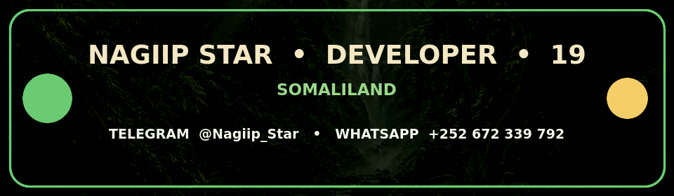

<p align="center">
  
</p>

<h1 align="center">🐍 Snake Forest 🌿</h1>

<p align="center">
  
</p>

<p align="center">
  <strong>Ciyaar abeeso desktop ah oo kayn qurux badan ku dhex socota — miro ururso, dhibco hel, hana isku dhicin!</strong>
</p>

<p align="center">
  
  
  
  
</p>

<p align="center">
  <a href="https://t.me/Nagiip_Star"></a>
  <a href="https://wa.me/252672339792"></a>
</p>

---

## 🌲 Ciyaarta

**Snake Forest** waa ciyaar abeeso (snake) ah oo desktop-ka Windows loogu talagalay. Ku hag abeesada kaynta, cun miraha dhalaalaya si ay u korto oo dhibco u hesho, kana fogow darbiyada iyo jirka abeesada. Muuqaal kayneed, sawirro iyo dhawaaqyo ciyaareed ayaa ku jira xirmada; ciyaartu internet uma baahna marka la rakibo.

Waxaa lagu dhisay **Python**, **PySide6** iyo **Pygame**. Settings-ka iyo natiijooyinka ciyaarta waxaa lagu kaydiyaa SQLite kombiyuutarkaaga oo keliya.

## ✨ Waxyaabaha ku jira

- 🌄 Shaashad furitaan iyo menu leh muuqaal kayneed iyo loading animation.
- 🐍 Abeeso si grid ah u dhaqaaqda; miro kasta oo la cuno wuxuu kordhiyaa dhibcaha **10**.
- 🏆 Best score, last score, tirada ciyaaraha iyo heerka ciyaaryahanka.
- 🎚️ Saddex heer oo adag: **Easy, Normal, Hard**; iyo saddex xawaare: **Slow, Normal, Fast**.
- ⏸️ Hakad, sii wadid, dib u bilowid iyo ku noqoshada menu-ga.
- 🔊 Codad ciyaareed, codka la hagaajin karo, iyo doorasho codka lagu damiyo.
- 🖥️ Full-screen, grid-ka looxa, iyo yareynta muuqaalada dhaqdhaqaaqa.
- 💾 Dhibcaha iyo settings-ka oo maxalli ahaan u kaydsan; ma jiro account ama internet loo baahan yahay.
- 📦 Portable Windows EXE hal-fayl ah iyo installer offline ah oo ikhtiyaari ah.

## 🎮 Sida loo ciyaaro

| Ficil | Furayaasha |
|---|---|
| Kor | `↑` ama `W` |
| Hoos | `↓` ama `S` |
| Bidix | `←` ama `A` |
| Midig | `→` ama `D` |
| Hakad / sii wad | `Space` ama `P` |
| Full-screen | `F11` |

Cun miraha si aad u hesho **10 dhibcood midkiiba** oo aad abeesada u dheereyso. Ha ku dhicin darbiga kaynta ama jirkaaga; abeesadu jihada si toos ah ugama noqon karto midda ka soo horjeedda. Haddii ciyaartu kugu adkaato ama aad rabto xawaare kale, ka beddel **Settings**.

## 🚀 Ku socodsii source code-ka

Waxaad u baahan tahay **Python 3.11, 3.12 ama 3.13 oo 64-bit ah**. Marka hore fur terminal-ka gudaha folder-ka mashruuca, dabadeed:

```bat
py -3.13 -m venv .venv
.venv\Scripts\activate
python -m pip install --upgrade pip
python -m pip install -r requirements.txt
python tools\prepare_assets.py
python main.py
```

`build_exe.bat` wuxuu si otomaatig ah u diyaariyaa assets-ka; tallaabada `prepare_assets.py` ee kor ku xusan waa ikhtiyaar marka kaliya source-ka la wado. Tijaabooyinka logic-ga iyo kaydinta xogta waxaa lagu ordi karaa:

```bat
python -m pytest -q tests
```

## 🪟 Sida Windows EXE dhab ah loo dhiso

Mashruucan wuxuu hore u leeyahay hab build oo Windows ah. **ZIP-gan source code ayuu wataa; EXE hore loo dhisay kuma jiro.** EXE-ga Windows waa in lagu dhisaa Windows 10/11 x64:

1. Ku rakib Python **3.11, 3.12 ama 3.13 (64-bit)**. Python 3.13 ayaa lagu talinayaa.
2. Haddii aad rabto installer-ka, ku rakib **Inno Setup 6**. Tani waa ikhtiyaari; portable EXE-gu ma u baahna.
3. Fur folder-ka `snake-forest` ee aad ZIP-ka ka furtay, kadib laba-jeer guji `build.bat` ama ka orod Command Prompt:

   ```bat
   build.bat
   ```

`build.bat` wuxuu u yeeraa `build_exe.bat`. Build-ku wuxuu hubiyaa Python/dependencies, diyaariyaa assets-ka, ordiyaa tests-ka, PyInstaller ayuu ku xiraa game-ka iyo runtime-ka hal EXE, kadibna wuxuu ka ordiyaa `--verify-bundle` gudaha `%TEMP%` si loo hubiyo in assets-ka xirmadu jiraan. Haddii Inno Setup 6 la helo, wuxuu sameeyaa installer offline ah; haddii aan la helin, script-ku si cad ayuu u sheegaa in installer-ka la booday. Dependencies ka maqan waxaa laga yaabaa in internet looga soo dejiyo **kombiyuutarka build-ka**; EXE-ga la dhammeeyayna uma baahna internet ciyaarta ama rakibidda.

### Faylasha build-ka

- `dist\SnakeForest.exe` — portable hal-fayl ah; kan u dir qof kale haddii uu rabo inuu ciyaaro isaga oo aan rakibin. Kombiyuutarka qaadanaya waa Windows 10/11 x64, mana u baahna Python ama source folder-ka.
- `installer-output\SnakeForest-Setup.exe` — installer-ka offline-ka ah; wuxuu soo baxaa **kaliya** marka Inno Setup 6 ku rakiban yahay kombiyuutarka build-ka. Wuxuu ku rakibaa `%LOCALAPPDATA%\Programs\Snake Forest`, wuxuuna ku daraa Start Menu shortcut iyo ikhtiyaar desktop shortcut.

Dhibcaha, settings-ka iyo log-yadu kama galaan folder-ka rakibidda. Waxaa lagu kaydiyaa `%LOCALAPPDATA%\SnakeForest` gudaha profile-ka isticmaalaha.

### Prompt-ka EXE-ga

Prompt-kan waa nooc Snake Forest loogu diyaariyey oo laga buuxiyey prompt-kii la soo gudbiyey. Faylka buuxa waxaa kale oo laga heli karaa [`PROMPT_WINDOWS_EXE.md`](PROMPT_WINDOWS_EXE.md); nuqulkii asalka ahaa waa [`PROMPT_FOR_REAL_EXE_ORIGINAL.txt`](PROMPT_FOR_REAL_EXE_ORIGINAL.txt).

<details>
<summary>🧩 Guji si aad u aragto prompt-ka buuxa ee build-ka</summary>

```text
Waxaan rabaa inaad dhamaystirto oo aad si sax ah u xirmayso project-kan desktop-ka ah ee Snake Forest, si uu ugu shaqeeyo Windows 10/11 x64.

SHARAXAADDA SOFTWARE-KA:
Snake Forest waa ciyaar desktop ah oo Python lagu qoray. Waxay isticmaashaa PySide6 interface-ka, Pygame dhaqdhaqaaqa iyo looxa ciyaarta, SQLite-na waxay ku kaydisaa settings-ka iyo dhibcaha maxalli ahaan. Ciyaaryahanku wuxuu maska ku hagaa kayn, miro ayuu ururiyaa (10 dhibcood midkiiba), wuxuuna iska ilaaliyaa darbiyada iyo jirka maska. Ciyaartu waxay leedahay Easy/Normal/Hard, Slow/Normal/Fast, pause/resume, restart, sound effects, fullscreen, grid iyo reduced-effects settings. Assets-ka sawirrada, icons-ka, font-yada iyo WAV-yada waxay ku jiraan assets/.

SHURUUDAHA MUHIIMKA AH:

1. Marka hore baar project-ka hadda jira, build scripts-ka, `SnakeForest.spec`, `SnakeForest.iss`, dependencies-ka iyo tests-ka. Hagaaji waxa maqan adigoo ilaalinaya UI-ga, game logic-ga, xogta kaydsan iyo assets-ka. Ha tirtirin ama dib ha u qorin wax aan loo baahnayn. Ha sheegan in wax la tijaabiyey haddii aan la tijaabin.

2. Diyaari labadan output:
   - Portable hal-fayl ah: `dist\SnakeForest.exe`
   - Installer offline ah: `installer-output\SnakeForest-Setup.exe`

3. Portable EXE-gu ha ku jiro app-ka, Python runtime-ka, dependencies-ka iyo dhammaan assets-ka runtime-ka looga baahan yahay. Kombiyuutarka Windows-ka lagu ciyaarayo looma baahna Python, development tools, source folder ama internet. EXE-gu yuusan ku tiirsanaan current working directory-ga; assets-ka ku xalliso habka ku habboon PyInstaller one-file.

4. Mashruucu waa Python, marka isticmaal PyInstaller one-file iyo `SnakeForest.spec` (ama si ula kac ah u cusboonaysii spec-ka haddii loo baahdo). Ku dar images, icons, fonts, sounds, hidden imports iyo dependencies dhab ahaan loo baahan yahay. Ha u beddelin hab packaging oo aan ku habboonayn stack-kan.

5. Hagaaji/ilaali `build.bat` iyo `build_exe.bat` si ay:
   - U hubiyaan 64-bit Python 3.11, 3.12 ama 3.13 iyo build dependencies-ka.
   - U diyaariyaan assets-ka, u ordiyaan `python -m pytest -q tests`, una dhisaan one-file EXE-ga.
   - U hubiyaan in `dist\SnakeForest.exe` la sameeyey.
   - U ordiyaan `SnakeForest.exe --verify-bundle` iyaga oo working directory-ga ka dhigaya `%TEMP%`, si loo hubiyo in resources-ku ku jiraan bundle-ka oo aan laga soo akhrinayn source folder-ka.
   - Haddii Inno Setup 6 (`ISCC.exe`) jiro, u dhisaan `installer-output\SnakeForest-Setup.exe`. Haddii aanu jirin, si cad u sheeg portable EXE-gu inuu diyaar yahay, installer-kana la booday; ha sheegin in installer la sameeyey.
   - Haddii build ama hubin fashilanto, muujiyaan qaladka oo exit code aan-guul ahayn bixiyaan.

6. Installer-ku ha noqdo x64 oo offline ku rakibma. Ku rakib user-ku qori karo folder sida `%LOCALAPPDATA%\Programs\Snake Forest`, ku dar Start Menu shortcut iyo desktop shortcut ikhtiyaari ah. Shortcuts-ku ha tilmaamaan EXE-ga la rakibay, ee yaanay tilmaamin `dist` ama source folder. Settings, saves iyo logs ku hay `%LOCALAPPDATA%\SnakeForest`, ee ha ku qorin install folder-ka.

7. Hubi in installer-ku xambaarsan yahay portable EXE-ga iyo wax kasta oo runtime-ka looga baahan yahay; rakibidda iyo ciyaartu yaanay u baahnayn internet. Dhammaadka sheeg meelaha saxda ah ee outputs-ka iyo midka loo diri karo kombiyuutar kale:
   - `dist\SnakeForest.exe`
   - `installer-output\SnakeForest-Setup.exe` (kaliya haddii Inno Setup 6 la heli karo)

8. Orod checks-ka environment-ku kuu oggol yahay. Kala saar waxa la xaqiijiyey iyo waxa aan la tijaabin. Ha odhan Windows EXE ayaa shaqeeyey kombiyuutar Windows/nadiif ah haddii aadan halkaas ku tijaabin. Haddii deegaankaagu aanu ahayn Windows ama aanu dhisi karin Windows EXE, si cad u sheeg xaddidaadda; diyaari ama sax build scripts-ka oo sii tilmaamaha Windows-ka lagu ordo.

Dhamee hawsha adigoo si toos ah u hagaajinaya faylasha project-ka; ha ku ekaan sharaxaad ama tusaale kood ah.
```

</details>

## 🗂️ Qaab-dhismeedka mashruuca

Liiska hoose wuxuu muujinayaa folder-yada iyo faylasha repo-ga oo dhan. Faylasha sawirrada, codadka iyo icons-ku waxay ku jiraan `assets/` waxaana EXE-ga lagu daraa iyada oo la adeegsanayo `SnakeForest.spec`.

<details>
<summary>📁 Muuji dhammaan folder structure-ka</summary>

```text
snake-forest/
├── app/
│   ├── __init__.py
│   ├── audio.py
│   ├── config.py
│   ├── database.py
│   ├── game_engine.py
│   └── resources.py
├── assets/
│   ├── fonts/
│   │   ├── DejaVuSans-Bold.ttf
│   │   ├── DejaVuSerif-Bold.ttf
│   │   └── LICENSE.txt
│   ├── icons/
│   │   └── fontawesome/
│   │       ├── apple-whole.svg
│   │       ├── arrow-down.svg
│   │       ├── arrow-left.svg
│   │       ├── arrow-right.svg
│   │       ├── arrow-up.svg
│   │       ├── bolt.svg
│   │       ├── bullseye.svg
│   │       ├── chart-bar.svg
│   │       ├── circle-check.svg
│   │       ├── circle-question.svg
│   │       ├── clock.svg
│   │       ├── expand.svg
│   │       ├── gamepad.svg
│   │       ├── gear.svg
│   │       ├── house.svg
│   │       ├── keyboard.svg
│   │       ├── LICENSE.txt
│   │       ├── medal.svg
│   │       ├── pause.svg
│   │       ├── play.svg
│   │       ├── rotate-right.svg
│   │       ├── trophy.svg
│   │       ├── volume-high.svg
│   │       ├── volume-xmark.svg
│   │       └── xmark.svg
│   ├── images/
│   │   ├── app_icon.ico
│   │   ├── app_icon.png
│   │   ├── developer-contact.gif
│   │   ├── forest-background.jpg
│   │   ├── forest-background.png
│   │   ├── forest-fruit.png
│   │   ├── logo.png
│   │   ├── readme-hero.gif
│   │   ├── snake-body.png
│   │   ├── snake-head.png
│   │   ├── snake-mascot.png
│   │   ├── snake-spritesheet.png
│   │   └── snake-tail.png
│   └── sounds/
│       ├── collect.wav
│       ├── game-over.wav
│       ├── game-start.wav
│       ├── high-score.wav
│       ├── pause.wav
│       └── ui-click.wav
├── installer-assets/
│   ├── wizard-image.bmp
│   └── wizard-small.bmp
├── tests/
│   ├── test_database.py
│   └── test_game_engine.py
├── tools/
│   └── prepare_assets.py
├── ui/
│   ├── __init__.py
│   ├── application.py
│   ├── common.py
│   ├── dashboard.py
│   ├── game_screen.py
│   ├── secondary_screens.py
│   └── splash.py
├── .gitignore
├── build.bat
├── build_exe.bat
├── INSTALLATION_NOTICE.txt
├── LICENSE
├── main.py
├── PROMPT_FOR_REAL_EXE_ORIGINAL.txt
├── PROMPT_WINDOWS_EXE.md
├── README.md
├── requirements.txt
├── SnakeForest.iss
└── SnakeForest.spec
```

</details>

| Folder / fayl | Waxa uu qabto |
|---|---|
| `app/` | Game engine, settings, SQLite database, cod iyo maaraynta resources-ka. |
| `ui/` | Shaashadaha splash, menu/dashboard, ciyaarta, settings iyo hagaha ciyaarta. |
| `assets/images/` | Logo, app icons, background kaynta, miro iyo snake sprites. |
| `assets/sounds/` | Lix cod oo WAV ah oo local ku shaqeeya. |
| `assets/icons/fontawesome/` | SVG icons iyo shatiga/attribution-kooda. |
| `assets/fonts/` | Font-yada lagu daray iyo liisankooda. |
| `installer-assets/` | Sawirrada wizard-ka Inno Setup. |
| `tests/` | Tijaabooyinka game engine-ka iyo xog-kaydinta. |
| `tools/` | Script-ka diyaariya/sameeya assets-ka game-ka. |
| `build.bat`, `build_exe.bat` | Bilowga build-ka Windows iyo samaynta EXE/installer-ka. |
| `SnakeForest.spec` | Dejinta PyInstaller one-file bundle-ka. |
| `SnakeForest.iss` | Dejinta Inno Setup offline installer-ka. |
| `PROMPT_WINDOWS_EXE.md` | Prompt-ka Windows EXE-ga ee Snake Forest loo habeeyey. |
| `PROMPT_FOR_REAL_EXE_ORIGINAL.txt` | Prompt-kii asalka ahaa ee la soo gudbiyey. |

## 🧰 Tignoolajiyada

- **Python 3.11–3.13** — luqadda iyo runtime-ka.
- **PySide6** — desktop interface-ka.
- **Pygame** — dhaqdhaqaaqa iyo sawiridda looxa ciyaarta.
- **SQLite** — settings, dhibco iyo taariikh maxalli ah.
- **PyInstaller** — portable one-file EXE.
- **Inno Setup 6** — installer-ka Windows ee ikhtiyaariga ah.

## 👨‍💻 Developer

**Nagiip Star** · 19 jir · ku nool Somaliland

<p align="center">
  
</p>

<p align="center">
  <a href="https://t.me/Nagiip_Star"></a>
  <a href="https://wa.me/252672339792"></a>
</p>

## 📜 Open source & licenses

Koodhka Snake Forest waa **open-source** waxaana lagu sii daayay **MIT License** — faahfaahinta ka eeg [`LICENSE`](LICENSE). Ogaysiisyada iyo shatiyada qaybaha dhinac saddexaad waa la ilaaliyey: eeg [`assets/icons/fontawesome/LICENSE.txt`](assets/icons/fontawesome/LICENSE.txt) iyo [`assets/fonts/LICENSE.txt`](assets/fonts/LICENSE.txt). Qaybahaas waxay raacayaan shatiyadooda u gaarka ah, mana beddelayso MIT-ga mashruuca.

---

<p align="center"><sub>Waxaa lagu dhisay 🌿 Somaliland · Snake Forest © 2026 Nagiip Star</sub></p>
